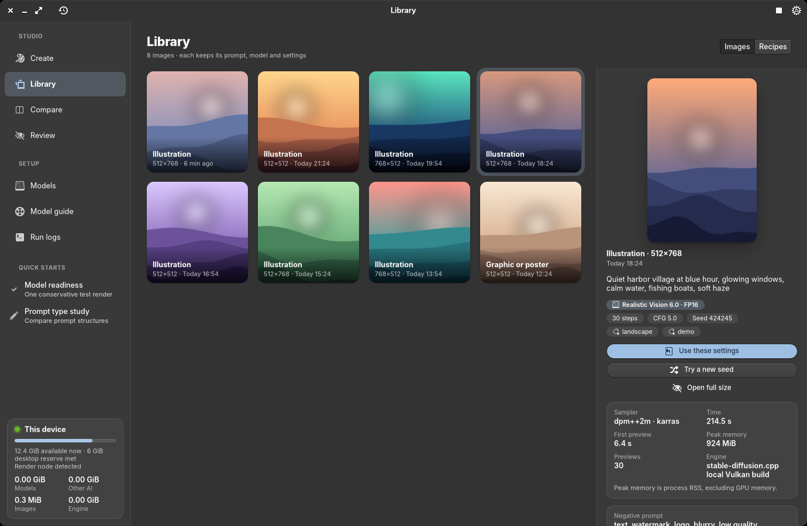

# M-Series Image Studio

Native GTK 4 + Granite 7 application using the repository's Pantheon SDK, pinned to `e15f9272`.
It follows the desktop's elementary stylesheet, font and color preference. The icon and D-Bus
launcher install per user without modifying desktop services.

## Install and open

From the repository root:

```sh
python3 mseries/image-studio/install-user.py
~/.local/bin/mseries-image-studio
```

The app appears as **Image Studio** in Applications. `--no-build` installs an already-built binary.
The executable is installed atomically under `~/.local/libexec/mseries-image-studio/`; updates do not
replace the inode of a running process. Reopen the application to load a newly installed build.

## UI and backend port

The UI is Claude's native canvas, filmstrip, gallery, model cards and stylesheet
from `claude/image-studio-native-ui`, including the working-tree source snapshot
recorded in `UI-PROVENANCE.json`. The original worktree is not edited by this port.
Backend integration adds settings roundtrip and readiness wiring without replacing
those screens. No new inference, benchmarks or model downloads were run for this
integration; validation is source inspection, Python syntax and Rust compile checking.

- Decoder: explicit CPU/Vulkan placement, tiled full VAE, 1–16 CPU threads,
  64–512 image-pixel tiles, saved disk/CPU/automatic weight placement and GPU budget.
- Preview: TAESD when installed, strictly preview-only; final PNG uses the full VAE.
  Preview interval is saved and restored, with real sampler steps distinct from frame count.
- Reference: SD 1.5 Plus Face + matching FP16 CLIP Vision, CPU vision execution,
  immutable image snapshot/hash, strength and component receipts retained per run.
- Batches: Generate with image count >1 uses a sequential queue, preserving reference
  and settings with a recorded seed per image; no automatic comparisons or reviews.
- Diagnostics: embedded structured logger, distinct loading/sampling/decoding/error
  states, no copied measurements from an older recipe, and shared generation locks.

See [upstream choices](UPSTREAM-DIFFUSION.md) for models, settings and kernel/driver
patch decisions. Runtime dependencies include `python3` and `python3-pil` for references.

## Design

Image Studio follows elementary OS conventions with a Draw Things-style creative workflow:
a flat header bar, a source-list sidebar (Studio and Setup sections, quick starts, and a live
memory meter for this device) and one scoped stylesheet in `src/style.rs` built on the
elementary stylesheet's named colors, so the accent, light/dark preference and fonts come from
the desktop. Overlays over images use a fixed dark glass so they read on any picture.

| Create | Library |
| --- | --- |
|  |  |

More states: [generating](docs/screenshots/image-studio-create-generating.png),
[light mode](docs/screenshots/image-studio-create-light.png),
[models](docs/screenshots/image-studio-models.png) and
[compare](docs/screenshots/image-studio-compare.png). All screenshots use the fictional demo
data from `rust/mseries-image-studio/tests/demo_data.py`, not real renders.

## Workspaces

- **Create:** a dotted canvas showing actual intermediate TAESD or projected-latent images during
  local sampling (status and step in a glass pill, progress along the bottom edge), reopening on the
  latest image, with a history filmstrip. A floating prompt dock holds the prompt, prompt type, Suggest
  type, Improve prompt, a collapsible negative prompt and the pill Generate button; chips under it
  summarize the next run. The inspector groups Model, Image, Sampling (real sliders), Seed, Reference
  image, LoRA and Advanced into collapsible cards with Save recipe pinned below. Header Stop and Reload
  recipe stay available; Ctrl+Enter runs the current recipe. Below about 1100 px the inspector moves
  into a Settings popover.
- **Library:** a gallery of every image; choosing one opens a detail pane with prompt, settings,
  measured timing and process memory, provenance, model notes, Use these settings, Try a new seed and a
  full-size viewer. A Recipes tab holds saved recipes. Completed jobs refresh the Library automatically.
- **Models:** SD 1.5 Q4/Q8, Realistic Vision FP16 + VAE, SDXL Turbo FP16, Qwen3-VL
  with its projector, the reference bundle, and TAESD; revision-pinned, size/SHA-256 verified downloads with progress and cancellation.
  Use selected model loads starter defaults. Engine setup builds pinned stable-diffusion.cpp.
- **Model guide:** task/capability matrix, source links, supported settings and local qualification
  limits. Engine support is distinguished from a verified app workflow.
- **Compare:** bounded sequential lighting, step or installed Q4/Q8 model sweeps with fixed seeds,
  saved manifests, per-result settings/measurements and optional vision review.
- **Review:** local Qwen vision rubric and optional visual reference, advisory scores/explanations,
  retained evaluator identity, image digest and a suggested prompt the user can explicitly apply.

The sidebar and Models show app model storage, shared AI model storage, images including previews and reference snapshots,
and the app-managed engine/source. Exported copies outside the app directory are not counted.

Data lives in `$XDG_DATA_HOME/mseries-image-studio` (normally `~/.local/share/mseries-image-studio`).
PNG sidecars retain prompts, model receipts, engine revision/arguments, sampler, steps, guidance,
resolved seed, dimensions, tags, timing and memory measurements. Hosted sample settings not exposed
by their provider remain unavailable; displayed editable starter settings do not reconstruct that run.

## Current hardware evidence

One M1 Pro / Honeykrisp trial of SD 1.5 Q4, 512×512, Euler, 8 steps, CFG 7, seed 424242 and batch 1
completed in 55.701 s. Eight real preview frames were produced; first preview took 4.021 s. Peak child
process RSS was 1957 MiB, excluding GPU memory. Minimum observed available host memory was
7308 MiB. Low-step baseline image quality is below the hosted sample project quality.

A sequential Qwen3-VL 2B Q4 / Q8-projector CPU review of that image completed in 94.439 s and
saved an advisory 2.8/5 report. This establishes pipeline operation, not evaluator accuracy.

Local inference preserves a continuously checked 6 GiB desktop reserve. Admission uses
selected dimensions, weight storage, GPU budget and reference components; figures are
estimates, not measured GPU allocation. Stop cancels the current image and queued images.
A run has a 15-minute limit. Vision review remains optional and runs after generation
unloads. Nothing starts inference or review simply by opening the app.

SD 1.5 Plus Face reference conditioning and CPU/GPU VAE paths retain earlier local
run evidence. This source-only integration makes no new image-quality or performance
claim. LoRA and inpainting remain outside this port. Q8/Turbo hardware qualification
remains outstanding. Prompt help uses the existing assistant at `127.0.0.1:8766`.

## Validation

```sh
CARGO_TARGET_DIR="$HOME/.cache/cargo-target" cargo test --manifest-path rust/Cargo.toml -p mseries-image-studio --lib
python3 rust/mseries-image-studio/tests/adapters.py
dbus-run-session -- env -u WAYLAND_DISPLAY CARGO_TARGET_DIR="$HOME/.cache/cargo-target" GDK_BACKEND=x11 GSETTINGS_BACKEND=memory GSK_RENDERER=cairo xvfb-run -a cargo test --manifest-path rust/Cargo.toml -p mseries-image-studio --test render
```

`M_SERIES_IMAGE_STUDIO_TEST_COMPACT=1` exercises the compact settings popover.

For visual review without touching real data, build the fictional fixtures and run a second
instance beside the installed app:

```sh
python3 rust/mseries-image-studio/tests/demo_data.py /tmp/demo --states   # fixtures, never real renders
XDG_DATA_HOME=/tmp/demo M_SERIES_IMAGE_STUDIO_DEV=1 M_SERIES_IMAGE_STUDIO_TEST_PAGE=library \
  M_SERIES_IMAGE_STUDIO_TEST_SELECT_IMAGE=1 M_SERIES_IMAGE_STUDIO_SCREENSHOT=/tmp/library.png \
  M_SERIES_IMAGE_STUDIO_EXIT_AFTER=4 ~/.cache/cargo-target/debug/mseries-image-studio
```

`M_SERIES_IMAGE_STUDIO_DEV` makes the instance non-unique, `..._TEST_PAGE` picks a page,
`..._TEST_SCHEME=light|dark` previews the other color scheme, and the screenshot hook clears the
backdrop dimming an unfocused window would otherwise show. Render fixtures and
transport tests are not AI inference; hardware measurements above come from the separate actual run.

Sources: [engine and preview support](https://github.com/leejet/stable-diffusion.cpp),
[SD 1.5 quantized files/license](https://huggingface.co/second-state/stable-diffusion-v1-5-GGUF),
[SDXL Turbo author settings/license](https://huggingface.co/stabilityai/sdxl-turbo),
[Qwen vision weights/projector](https://huggingface.co/Qwen/Qwen3-VL-2B-Instruct-GGUF).
