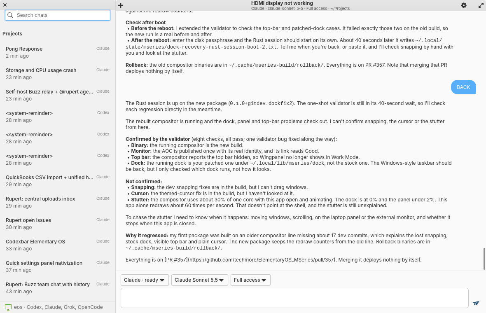

# Claude for elementary OS (Rust)

A native Pantheon client for AI coding agents: Claude Code, Codex, OpenCode and Grok through the
[T3 Code](https://github.com/pingdotgg/t3code) server, with your local Claude Code transcripts
(`~/.claude/projects/*/*.jsonl`) as the offline view. gtk4-rs 0.11 + granite-rs 3.3, one process,
~75 MB, no CPU at idle. Built to replace the Electron desktop app (19 processes, 2.4 GB) on an
Apple Silicon Mac running elementary OS; numbers in [`docs/PERFORMANCE.md`](docs/PERFORMANCE.md).



## Build and run

```sh
cargo build --release
./target/release/claude-pantheon-rs            # or, with the shared target dir in ~/.cargo/config.toml:
~/.cache/cargo-target/release/claude-pantheon-rs
```

Toolchain: Rust 1.99, system GTK 4.22 and Granite 7.8 (`libgranite-7-dev`), plus `libgtksourceview-5-dev` (code blocks), `libvte-2.91-gtk4-dev` (terminal pane) and `libwebkitgtk-6.0-dev` (visual replies; the web process starts only when a page is shown).

Other entry points:

| Command | What |
|---|---|
| `claude-pantheon-rs --index` | list the offline sessions the sidebar shows, with timing |
| `claude-pantheon-rs --quit-after-frame` | draw one frame, print the start-up time, exit (benchmarks) |
| `claude-pantheon-rs --t3-dump DIR [TOKEN]` | record the server's answers as JSON (fixtures); pairs first when a token is given |
| `claude-pantheon-rs --t3-call TAG [JSON]` | one RPC call with the stored credential |
| `CLAUDE_PANTHEON_OPEN=<id>` | open that thread or session at start |
| `CLAUDE_PANTHEON_OFFLINE=1` | never connect; transcripts only |
| `CLAUDE_PANTHEON_RENDERER=gl` | use a GL renderer instead of cairo (see PERFORMANCE.md) |
| `CLAUDE_PANTHEON_DEBUG=1` | log RPC frames to stderr |

## Keyboard shortcuts

| Keys | Action |
|---|---|
| Ctrl+N | New thread |
| Ctrl+K | Command palette (the thread search until the palette lands) |
| Ctrl+F | Search threads |
| Enter | Send (Shift+Enter inserts a newline; Ctrl+Enter also sends) |
| Ctrl+W | Close the thread |
| Ctrl+Shift+U | Usage |
| Ctrl+, | Settings (appearance, defaults per project, server, notifications, renderer) |
| Ctrl+Shift+T | Terminal pane for the open thread (the server's PTY, no local shell) |
| Ctrl+Shift+S | SnapShot: screenshot through the portal, named after the focused window, attached to the draft |
| Ctrl+Q | Quit |
| Y / N | Allow once / deny the oldest waiting permission prompt (when not typing) |

The same actions sit in the app menu (header bar, right) with their accelerator labels, plus Repos
and Issues, Changes, Diagnostics, Import Sessions, Hand Off to Repo, Open Offline Twin, Reconnect,
Forget Pairing and About (version, server, providers ready).

## Sidebar

Threads sit under their project with the provider's accent dot, a spinner while a turn runs, a
"?" badge when a prompt waits and a blue dot for activity since the last visit (the server's
`lastVisitedAt`; opening a thread records a visit). Pinned threads lead their section. Right-click or
long-press a thread for Pin, Rename, Hand Off to Repo, Copy Link (a `claude-pantheon-rs --thread <id>`
command) and Archive. Section headers collapse on click and project headers can be dragged into the
order you want; both persist in `~/.config/claude-pantheon-rs/sidebar.json`.

## Composer

The message box grows to eight lines and then scrolls. Paste or drop images and files to attach
them: each becomes a chip, uploaded through the server's `attachments.createUploadUrl` and sent with
the message (10 attachments, 10 MB per image, 50 MB per file). Typing `@` opens a fuzzy picker over the
thread's project (`projects.searchEntries`) and inserts `@path`. The draft is kept per thread in
`~/.cache/claude-pantheon-rs/drafts.json` and comes back when the thread is reopened, across restarts.

## Pairing with the server

The server is `t3 serve` (here: the user service `t3code.service` on `127.0.0.1:3773`). Run `t3 pair`,
paste the token or the pairing URL into the first-run page. The pairing token is exchanged once for a
bearer session (`/oauth/token`); the session goes to the keyring (`secret-tool`) or, without one, to
`~/.config/claude-pantheon-rs/credentials.json` (0600). Each connection mints a short-lived WebSocket
ticket and opens `/ws?orchestrationProtocol=2`; a server that wants a newer client answers 426 and
its message is shown on the pairing page.

On loopback the client also points the server's Claude provider at the Claude Code CLI bundled with
the desktop app (`~/.config/Claude/claude-code/<version>/<hash>/claude`) when the server cannot find
`claude` on PATH.

## What is where

| Path | Role |
|---|---|
| `src/t3/ws.rs`, `http.rs` | RFC 6455 client and HTTP/1.1 on gio sockets, all on the GLib loop |
| `src/t3/rpc.rs` | Effect-RPC JSON envelopes: Request/Chunk/Exit/Ack/Interrupt/Ping |
| `src/t3/auth.rs` | pairing, tickets, credential storage |
| `src/t3/model.rs` | lenient serde views of providers, shell, thread projections, usage, plan windows, rotation rule |
| `src/transcript.rs`, `index.rs` | JSONL parser and the cached session index (`~/.cache/claude-pantheon-rs`) |
| `src/app.rs` | the window: sidebar, live thread, composer, pages |
| `src/chat.rs` | message, tool-row, diff and permission-prompt widgets |
| `src/render.rs` | Markdown (pulldown-cmark) as widgets; fenced code in GtkSourceView 5 with copy and wrap |
| `src/usage.rs` | Usage page (CodexBar style) and plan-window gauges |
| `src/workflow.rs`, `repos.rs` | pinned repos, issue backlog via `gh api`, "Start on this", the runner as T3 scheduled tasks |
| `src/handoff.rs` | "Hand Off to Repo": structured summary appended to the project's handoff doc, optional commit |
| `src/changes.rs` | Changes page: file tree, inline/side-by-side diff in GtkSourceView, per-hunk copy, restore to checkpoint |
| `src/diagnostics.rs` | the server's resource telemetry as sparklines |
| `tests/render.rs` | drives the real window under Xvfb and writes the screenshots in `docs/` |
| `bench.sh` | RSS and CPU of a process tree over 20 s, as a Markdown row |

Design notes: [`docs/T3-SPIKE.md`](docs/T3-SPIKE.md) (why the server), [`docs/INTEGRATIONS.md`](docs/INTEGRATIONS.md)
(native replacements for T3's platform helpers), [`docs/WORKFLOW.md`](docs/WORKFLOW.md) (issues, lanes, runner).

## Tests and screenshots

```sh
cargo test --release --lib
dbus-run-session -- env -u WAYLAND_DISPLAY GDK_BACKEND=x11 GSETTINGS_BACKEND=memory \
  CLAUDE_PANTHEON_SHOT=docs/screenshot-m1.png CLAUDE_PANTHEON_SHOT_M2=docs/screenshot-m2.png \
  CLAUDE_PANTHEON_SHOT_M3=docs/screenshot-m3.png \
  xvfb-run -a -s "-screen 0 1400x900x24" cargo test --release --test render
```

The render test needs the real transcripts and, for the live parts, a stored credential (under the
test's D-Bus session the keyring is not reachable: copy the credential JSON to
`$XDG_CONFIG_HOME/claude-pantheon-rs/credentials.json` for the run). `CLAUDE_PANTHEON_LIVE_SEND=1`
also starts a real thread and waits for its answer.

## Install

```sh
./install.sh                    # release build + install under ~/.local: binary, .desktop (New Thread and
                                # Usage actions, D-Bus activation), metainfo, hicolor icons 16…128 + symbolic
./install.sh --prefix /usr      # system-wide (sudo for the copy)
./install.sh --uninstall
bash mseries/install-claude-pantheon-rs.sh   # the same from the repo root, with the build requirements check
```

The script restarts `pantheon-dock` at the end: the dock keeps showing a placeholder icon for a newly
installed app until it is restarted. The D-Bus service file lets the desktop entry and
`gapplication launch io.github.techmore.ClaudePantheonRs` start the app; a second launch, the desktop
actions and `gapplication action io.github.techmore.ClaudePantheonRs new-thread` all reach the running
window.

## Visual replies

When an agent answers with a page (the `html_render` tool), the turn shows a card with the page title and a **Show page** button. The WebKitGTK view (and its web process) is created only when that button is pressed and freed with the card's close button, so an idle window has no web process. Links open in the browser; a Granite palette style sheet makes unstyled pages follow light and dark; full screen opens the page in its own window (Escape closes it). Signed asset URLs come from `assets.createUrl` on each open.
