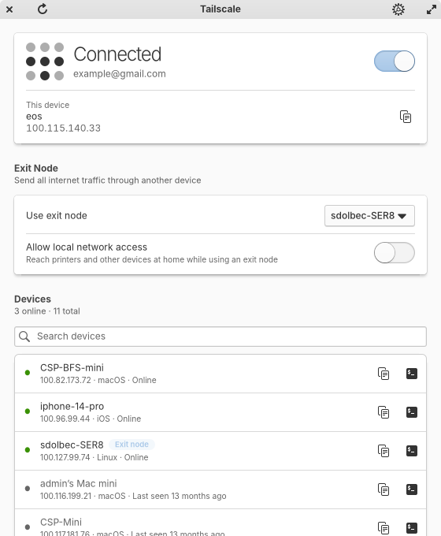
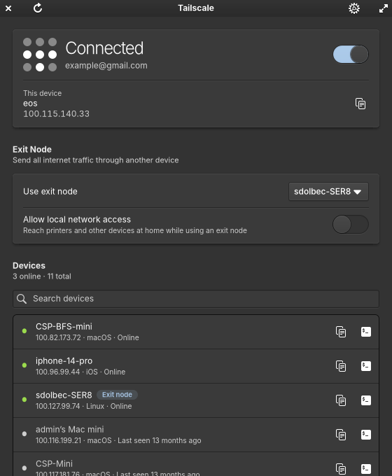
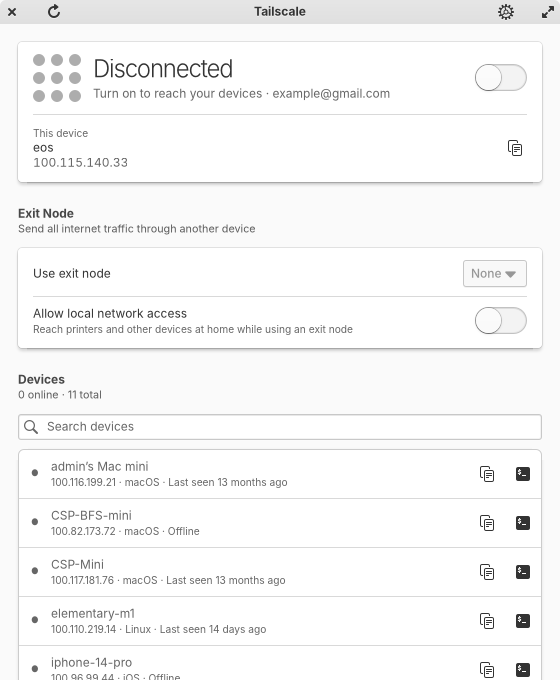
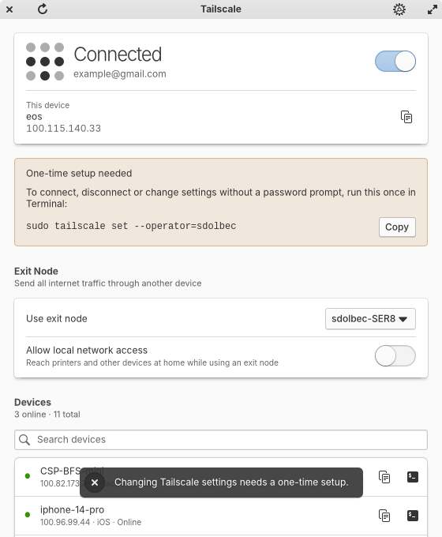
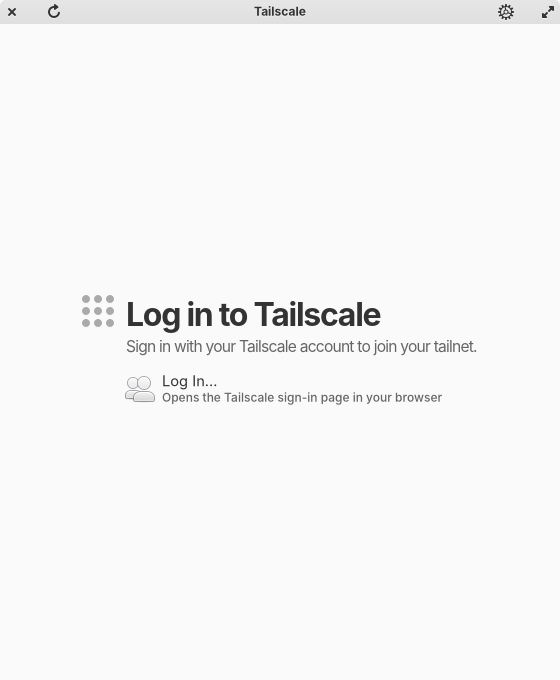
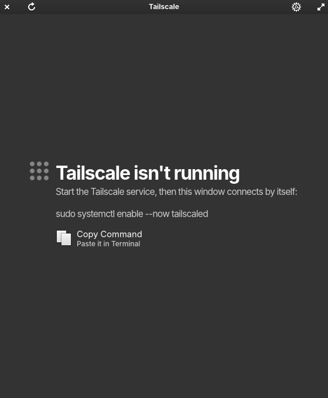

# Tailscale

A native Pantheon window for Tailscale. It replaces the old launcher that opened Tailscale's read-only web page
(`http://100.100.100.100/`) in a browser tab.

| Connected | Dark |
| --- | --- |
|  |  |
| **Disconnected** | **A refused change shows the one-time setup** |
|  |  |
| **Logged out** | **Service not running** |
|  |  |

## What it does

- **Status card:** connected or disconnected, tailnet and account, and a switch that runs `tailscale up` / `down`.
  This device's name and IP, with a copy button.
- **Exit node:** pick any device that offers itself as an exit node (`tailscale set --exit-node=IP`), or None, and
  allow local network access while using one.
- **Devices:** every device on the tailnet, online first, with IP, OS and when it was last seen. Search with
  Ctrl+F. Click a row or the copy button to copy its IP; the terminal button copies `ssh <name>`
  (the MagicDNS name, e.g. `ssh sdolbec-ser8`).
- **Settings:** Tailscale DNS, subnet routes, incoming connections (shields up), and the Tailscale SSH server,
  each a `tailscale set` flag.
- **Logged out:** "Log In…" starts `tailscale login` and opens the sign-in page.
- **Service not running:** says so and copies `sudo systemctl enable --now tailscaled`.

Reading needs no root. Changes need the operator setting; without it Tailscale refuses ("access denied"), every
control springs back to the real state, and the window shows the one-time command with a Copy button:

```sh
sudo tailscale set --operator=$USER
```

The window refreshes every 3 s while it is open, after each change, and on Ctrl+R / F5.

## Build, install, screenshots

```sh
rust/mseries-tailscale/install-local.sh          # ~/.local, no sudo
rust/mseries-tailscale/snapshot.sh OUT_DIR        # light/dark PNGs from fixtures/ under Xvfb
cargo test -p mseries-tailscale                   # parsing and error classification
```

`MSERIES_TAILSCALE_FIXTURES=DIR` makes the app read `status.json` / `prefs.json` from DIR (every change is then
refused, which is how the setup-banner screenshot is made with `MSERIES_TAILSCALE_SNAPSHOT_TOGGLE=1`).

## Icon

The app icon and the status icons redraw the Tailscale logo from the dot layout in Tailscale's own tray code,
[`client/systray/logo.go`](https://github.com/tailscale/tailscale/blob/v1.104.4/client/systray/logo.go)
(BSD-3-Clause, © Tailscale Inc & contributors): lit dots when connected, all grey when not. The Tailscale name
and logo are trademarks of Tailscale Inc., used here only to label Tailscale itself.

The top-panel menu and Work Mode taskbar button live in the OS repo
(techmore/ElementaryOS_MSeries `mseries/tailscale-wingpanel`).
